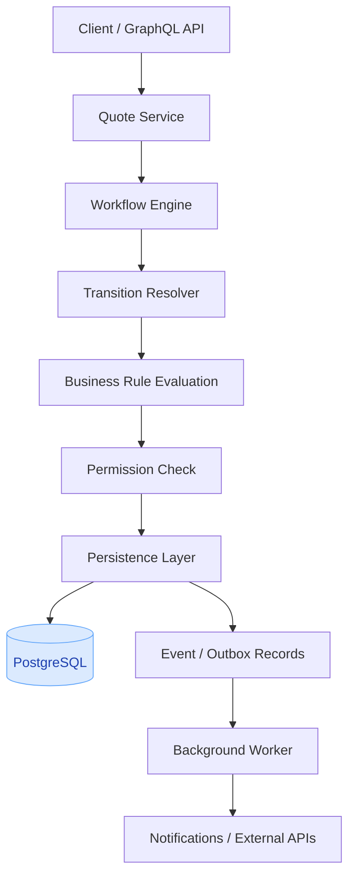

# An Oracle BMI-style Workflow Engine from Scratch (Go + PostgreSQL + GraphQL)
> **It is a learning implementation inspired by Oracle's documented quote workflows, not a claim about its proprietary implementation.**  

A workflow engine that controls the lifecycle of a quote: creation, persistence, validation, status transitions, approvals, and event processing.   
## Tech-stack
|Component	|Technology	|Responsibility|
|------|--------|--------|
|Programming language	|Go	|Workflow and business logic|
|API layer	|GraphQL + gqlgen	|Quote queries and commands|
|Database	|PostgreSQL	|Quote persistence and transactions|
|Database driver	|pgx	|Database access|
|Cache (later)	|Redis	|Cached reads or auxiliary data|
|Messaging (later)	|NATS or Kafka	|Workflow events|
|Internal APIs (later)	|gRPC + Protobuf	|Service-to-service communication|
|Testing|	Go testing + Testcontainers	|Unit and integration tests|
---

## the architecture

|Component	|What you implement|
|---|---|
|Quote Service	|Create, update, and retrieve quotes|
|Workflow Engine	|Execute actions against a quote|
|Transition Resolver	|Determine the next status|
|Rule Evaluator	|Validate approval and pricing rules|
|Permission Checker	|Determine who can execute an action|
|Persistence Layer	|Atomically save quotes and events|
|Background Worker	|Handle notifications, retries, and integrations|