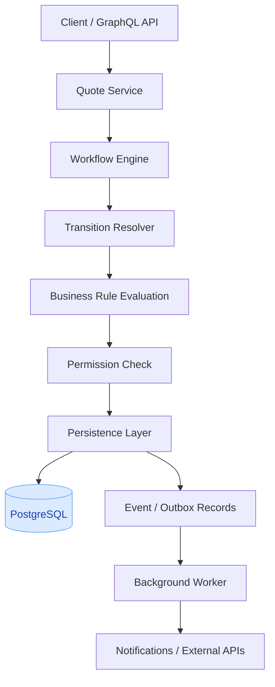
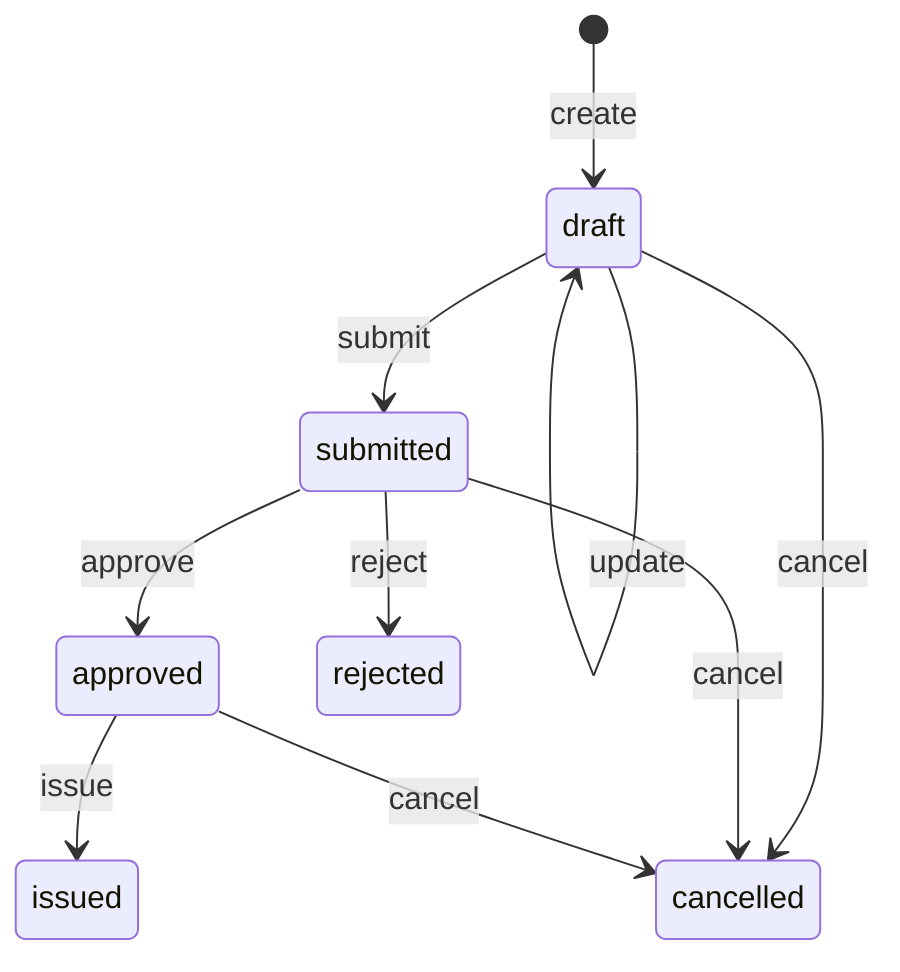

# An Oracle BMI-style Workflow Engine from Scratch (Go + PostgreSQL + GraphQL)
> **It is a learning implementation inspired by Oracle's documented quote workflows, not a claim about its proprietary implementation.**  

A workflow engine that controls the lifecycle of a quote: creation, persistence, validation, status transitions, approvals, and event processing.   
## Tech-stack
|Component	|Technology	|Responsibility|
|------|--------|--------|
|Programming language	|Go	|Workflow and business logic|
|API layer	|GraphQL + gqlgen	|Quote queries and commands|
|Database	|PostgreSQL	|Quote persistence and transactions|
|Database driver	|pgx	|Database access|
|Cache (later)	|Redis	|Cached reads or auxiliary data|
|Messaging (later)	|NATS or Kafka	|Workflow events|
|Internal APIs (later)	|gRPC + Protobuf	|Service-to-service communication|
|Testing|	Go testing + native PostgreSQL	|Unit and integration tests|
---

## the architecture

|Component	|What you implement|
|---|---|
|Quote Service	|Create, update, and retrieve quotes|
|Workflow Engine	|Execute actions against a quote|
|Transition Resolver	|Determine the next status|
|Rule Evaluator	|Validate approval and pricing rules|
|Permission Checker	|Determine who can execute an action|
|Persistence Layer	|Atomically save quotes and events|
|Background Worker	|Handle notifications, retries, and integrations|

## MVP acceptance checklist

The MVP is a complete quote lifecycle using Go, gqlgen, and PostgreSQL. These features are implemented:

- [x] Create and retrieve quotes; edit reference, currency, and price while in draft.
- [x] Execute submit, approve, reject, issue, and cancel actions through an explicit transition resolver.
- [x] Validate inputs and pricing; require a separate person to approve or reject a quote.
- [x] Authenticate API requests and check roles and quote ownership inside the workflow service.
- [x] Use optimistic version checks to prevent concurrent commands from overwriting each other.
- [x] Atomically persist the quote, a versioned audit snapshot, and an outbox entry with pgx transactions.
- [x] Query quotes and history and run commands through GraphQL; retain the original REST transport.
- [x] Process committed events in a background worker with leases, retries, and dead letters; log events or deliver an optional webhook.
- [x] Run unit/API tests and integration tests against native PostgreSQL, including rollback and concurrency cases.
- [x] Provide embedded migrations, health/readiness endpoints, native WSL setup, and CI checks.

Redis, NATS/Kafka, gRPC, a visual workflow designer, search/list pagination, quote line items/discounts, production identity integration, and real Oracle endpoints are later work. The MVP's pricing and approval policies below are explicit learning assumptions, not Oracle product rules.

## Run locally in WSL

The application, PostgreSQL, and tests run directly in Ubuntu on WSL. Go 1.26+ is required; the setup script installs PostgreSQL and the C compiler used by Go's race detector:

```sh
bash scripts/setup-wsl.sh
make run
```

Run setup as your normal WSL user and enter your sudo password in the terminal when requested. It installs packages with apt, starts PostgreSQL, and creates the `workflow` role plus `workflow` and `workflow_test` databases. It creates `.env` from `.env.example` with restricted permissions if the file is missing, and preserves existing configuration and database objects. The credentials in the example are for local development. Existing PostgreSQL roles keep their passwords; update `.env` if your installation uses different credentials.

`make run` automatically loads `.env` and starts the API as your WSL user. Stop it with Ctrl+C. PostgreSQL runs as a native system service and retains its data across API restarts. On WSL with systemd, manage it with `sudo systemctl start postgresql`, `sudo systemctl status postgresql`, or `sudo systemctl stop postgresql`. Without systemd, setup uses `sudo service postgresql start`.

Open http://localhost:8080/playground and add this HTTP header in the playground:

```json
{"Authorization":"Bearer sales-demo-token"}
```

The application automatically applies its embedded PostgreSQL migration on startup under a database lock. The initial migration replaces the earlier Oracle SQL prototype and targets a fresh PostgreSQL database.

If PostgreSQL is already installed, create a database owned by your development role, configure `DATABASE_URL` and `TEST_DATABASE_URL` in `.env`, then run `make run` and `make integration-local`. The test user needs permission to create schemas in its test database. Each integration run creates and removes its own randomly named schema, preserving application data.

For a temporary demo without PostgreSQL, load the local environment and select memory storage:

```sh
set -a
. ./.env
set +a
STORE=memory go run ./cmd/api
```

Quotes and events disappear when this mode stops.

| Configuration | Meaning |
| --- | --- |
| `STORE` | `postgres` (default) or `memory` |
| `DATABASE_URL` | Required for PostgreSQL; `.env.example` has a local development connection string |
| `TEST_DATABASE_URL` | Required PostgreSQL connection string for integration tests |
| `AUTH_TOKENS` | Required JSON map from bearer tokens to `{ "id": "...", "role": "sales\|approver\|admin" }` |
| `HTTP_ADDR` | Defaults to `127.0.0.1:8080` |
| `EVENT_WEBHOOK_URL` | Optional HTTP(S) receiver; absent means events are written to structured logs |

Sample credentials are for local development. Actors and roles come from the server's token configuration; clients cannot supply an `actor` field to impersonate someone. Token authentication is an MVP adapter; use a trusted identity provider and TLS for a public deployment.

`GET /healthz` reports process liveness. `GET /readyz` checks the database connection (always ready in memory mode). Both endpoints, the landing page, and playground are public. Quote data and GraphQL require authentication.

## Workflow and policies



Issued, rejected, and cancelled quotes are terminal. Drafts may have a zero amount; submission requires a positive amount. Reference is nonblank and at most 200 bytes, currency is exactly three uppercase ASCII letters, and amount is a nonnegative signed 64-bit integer in minor currency units. The currency check validates syntax; it does not maintain an ISO currency registry. All submitted quotes require approval, and submitted pricing is frozen.

| Role | Read/history | Create | Edit/submit/issue/cancel | Approve/reject |
| --- | --- | --- | --- | --- |
| `sales` | Own quotes | Yes | Own quotes, when the state permits | No |
| `approver` | All quotes | No | No | Submitted quotes owned by someone else |
| `admin` | All quotes | Yes | All quotes, when the state permits | Submitted quotes owned by someone else |

Every successful command advances `version` once and produces exactly one audit event and outbox entry. Updates and actions require the current version. After a conflict, query the quote again before deciding whether to retry. Invalid actions, failed rules, denied permissions, and stale versions do not change the quote or produce events.

## GraphQL examples

Send operations to `POST /graphql` with `Content-Type: application/json` and an `Authorization: Bearer ...` header. `Int64` values (amount and version) are returned as decimal **strings** so JavaScript clients retain all 64 bits. Send decimal strings for these inputs too.

Create a draft using the sales token:

```graphql
mutation {
  createQuote(input: {reference: "Q-001", currency: "USD", amountMinor: "12500"}) {
    id reference amountMinor owner state version
  }
}
```

Copy the returned ID into these variables:

```json
{"id":"<quote-id>","version":"1"}
```

Optionally edit the draft. This command replaces all editable fields and returns version `2`:

```graphql
mutation Edit($id: ID!, $version: Int64!) {
  updateQuote(id: $id, input: {version: $version, reference: "Q-001-revised", currency: "USD", amountMinor: "13000"}) {
    id reference amountMinor state version
  }
}
```

Use the latest version and execute `SUBMIT` with the sales token:

```graphql
mutation Submit($id: ID!, $version: Int64!) {
  executeQuoteAction(id: $id, version: $version, action: SUBMIT) {
    id state version
  }
}
```

Run the same action mutation with `action: APPROVE`, the returned version, and header `Bearer approver-demo-token`. Then run `action: ISSUE` with the next version and the sales token. `REJECT` and `CANCEL` follow the transition table above.

Read the current quote and immutable audit snapshots:

```graphql
query QuoteAndHistory($id: ID!) {
  quote(id: $id) { id reference currency amountMinor owner state version }
  quoteHistory(id: $id) {
    version action from to actor at
    quote { reference amountMinor state }
  }
}
```

GraphQL domain errors have stable `errors[].extensions.code` values: `UNAUTHENTICATED`, `FORBIDDEN`, `NOT_FOUND`, `CONFLICT`, `BAD_USER_INPUT`, `TRANSITION_NOT_ALLOWED`, and `BUSINESS_RULE_FAILED`. Internal failures return a generic message and are logged. Missing/invalid bearer tokens are rejected with HTTP 401 before GraphQL executes.

## REST endpoints

The REST transport uses the same workflow service and bearer tokens. Request JSON uses snake_case and numeric amounts/versions. The original target-state endpoint remains available; actor values now come from authentication.

| Method and path | Body / result |
| --- | --- |
| `POST /quotes` | `{ "reference": "Q-001", "currency": "USD", "amount_minor": 12500 }`; creates draft |
| `GET /quotes/{id}` | Current quote |
| `PUT /quotes/{id}` | `{ "version": 1, "reference": "revised", "currency": "USD", "amount_minor": 13000 }`; edits draft |
| `POST /quotes/{id}/actions` | `{ "version": 2, "action": "submit" }` |
| `POST /quotes/{id}/transitions` | `{ "version": 2, "to": "submitted" }` |
| `GET /quotes/{id}/history` | Audit events with quote snapshots |

```sh
curl http://localhost:8080/quotes \
  -H 'Authorization: Bearer sales-demo-token' \
  -H 'Content-Type: application/json' \
  -d '{"reference":"Q-001","currency":"USD","amount_minor":12500}'
```

REST errors use 400 for invalid input, 401 for missing identity, 403 for permission denial, 404 for missing quotes, 409 for stale versions, and 422 for invalid transitions or business rules.

## Event delivery

The worker starts with the API and polls the transactional outbox. Set `EVENT_WEBHOOK_URL` to send each event's JSON snapshot to a receiver; otherwise the worker logs quote ID, version, and action. HTTP 2xx acknowledges delivery. Timeouts, redirects, and other responses count as failures. Requests time out after 10 seconds; a claim expires after 30 seconds so another worker can recover it after a crash.

Delivery is **at least once**. The receiver must deduplicate the stable `Idempotency-Key: <quote-id>:<version>` header. Delivery order is not guaranteed across retries or workers; consumers should use quote versions. Remote delivery and the local acknowledgement cannot share a transaction. Webhook failures never roll back a committed quote, and the MVP does not run compensating quote actions.

Failures retry with 1, 2, 4, and 8 second delays. After five failed attempts, the entry is retained with `dead_at` and `last_error` for inspection. An operator can requeue a reviewed dead entry:

```sql
SELECT id, quote_id, version, attempts, last_error FROM outbox WHERE dead_at IS NOT NULL;
UPDATE outbox SET attempts = 0, dead_at = NULL, last_error = NULL,
    lease_token = NULL, available_at = now()
WHERE id = <reviewed-id> AND dead_at IS NOT NULL;
```

Memory mode implements the same delivery contract but does not retain data after restart.

## Verification and development

```sh
make test           # Unit, auth, REST, GraphQL, and worker tests; no database required
make integration-local # All tests with the race detector against native PostgreSQL
make integration    # Loads .env; runs integration tests using TEST_DATABASE_URL
make race           # Unit/API tests under the race detector; C compiler required
make check          # go vet and unit/API tests
make generate       # Regenerate checked-in code using the gqlgen version in go.mod
make build
```

CI installs native PostgreSQL using the setup script and runs the same isolated-schema integration suite as WSL. Integration tests require `TEST_DATABASE_URL` and report a clear error when it is missing. CI runs `go vet`, all tests with the race detector through `make integration-local`, and verifies that gqlgen regeneration produces no diff. The integration suite proves transactional rollback when an outbox insert fails, persistence across connections, compare-and-swap under concurrent commands, exclusive worker claims, stale lease rejection, and dead-letter persistence. See [docs/architecture.md](docs/architecture.md) for the storage and delivery boundaries.

Primary library references: [gqlgen configuration](https://gqlgen.com/config/) and [pgx connection pools](https://github.com/jackc/pgx/wiki/Getting-started-with-pgx).
